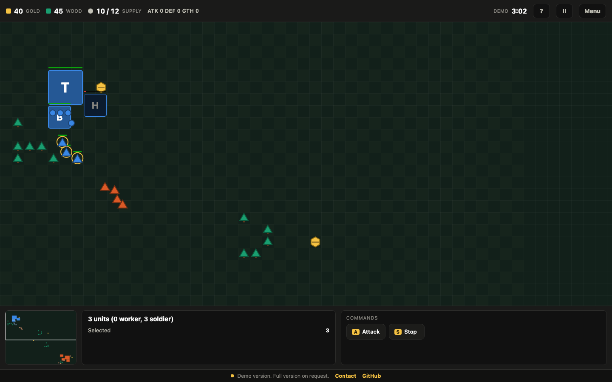

# RTS Skirmish

A real-time strategy game built from scratch on HTML5 canvas: no game engine, no framework, no asset files.

## What it does

- **Two-resource economy.** Workers mine gold and chop wood, carry it back to the Town Hall, and every node runs dry over time, so map control matters.
- **Base building and production.** Place a Barracks and Houses on a tile grid, follow live construction and training progress, and manage a supply cap.
- **Tech upgrades.** Attack, Armor and Gather research with rising costs that last for the rest of the match.
- **Real unit AI.** A* pathfinding around buildings and forests, separation steering so units never stack, context-sensitive orders, and soldiers that pick their own targets.
- **A computer opponent.** It grows its economy, expands supply, builds an army, buys upgrades and launches attacks on your base.
- **Classic RTS controls on mouse and touch.** Box select, right-click commands, attack-move, control groups, a clickable minimap and edge panning.

## How it works

- **Simulation layer.** A world model holds units, buildings and resources and runs a chain of small systems on every fixed step: production, AI, orders, movement, combat, gathering, construction, cleanup and the win check. It has no knowledge of the screen.
- **Core layer.** Pure functions for grid A* with an octile heuristic and a binary-heap open list, nearest-free-tile search, and the economy and combat formulas.
- **Presentation layer.** A canvas renderer with camera culling, a minimap, a HUD and a contextual command card. Mouse, keyboard and touch input only ever issue commands to the simulation.
- **Deterministic timing.** A fixed 60 Hz simulation step, decoupled from the display refresh rate, so the game plays the same on 60 Hz and 120 Hz screens. A seeded random generator keeps maps and AI decisions reproducible.
- **Runtime audio.** Sound effects are synthesized with WebAudio, so the game ships with zero media files.

## Stack

JavaScript (no dependencies), HTML5 Canvas 2D, WebAudio, CSS.

## Live demo

Live demo: https://artinbahmani.artin-bahmani0.workers.dev/rts-skirmish/

The demo runs one map against the Easy AI with a 5 minute match limit. While the menu is open, a live AI versus AI skirmish plays in the background.

## Full version

Source code is private. To use it in your business or get the full version, contact me: artin.bahmani0@gmail.com

Copyright (c) 2026 Artin Bahmani. All rights reserved.
